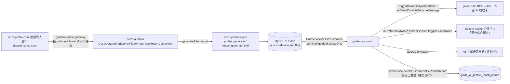

# briar-youzan-ai-profile-push — 指定导购推一客一策

> 只用于 QA/预发测试店铺与测试导购。写接口（导入、生成、触发通知、重置触达）**不得**对生产调用；
> `zan-dubbo-invoke` 在预发/生产只允许只读方法，写操作在 QA 跑，或由用户本人在 Dubbo 控制台/Ticket 平台手动执行。
> 用户在场时，也可用 kimi-webbridge 在用户已登录的 `ticket.qima-inc.com` 页面上下文直接
> `POST /api/v1/dubbo/invoke`（body 同 DubboMan：`{app,env,service,method,args,sc,timeout,retries}`），与手动点 Send 等价。
> zan-dubbo-invoke 登录态失效时，只读查询同样可走这个通道（只读方法不受 Ticket 白名单限制）。

## 快速通道（例行造数）

`scripts/ai_profile_push.py` 把下文步骤 1B → 2 固化成一条命令（选客户 → `appendCustomer` → 轮询 `reGenState` → 对比 `pendingCount`）：

```bash
python3 ai_profile_push.py run --env pre --rootKdtId <rootKdtId> --guideId <guideId> -n 2
```

其他子命令：`pool`（池内状态：operateType / reGenState / reachTime）、`pending`（今日待触达队列）、`generate`（单客户 `mockGenerate` 兜底）、`reset`（删触达记录，重复测试）。写操作仅 qa/pre，禁止 prod。脚本口径与下文一致，run 报 WARN/HINT 时回到对应步骤手动排查。

## 链路总览



关键点：一客一策客户按 **`adminId` = 导购有赞 userId（guideId）** 归属；guide-promotion 只读「今天」的推荐（`operate_time` 为当天、`operateType=1`，前 100 条），并排除近 3 天已触达（`guide_ai_profile_reach_record` 去重窗口 = [当天零点, +3 天零点），触达记录可删后重新下发）。所以「推给某导购」= 让该导购名下今天有带话术的客户 + 触发下发。

## 前置

1. 确认环境（QA / 预发）、总部 `rootKdtId`、导购 `guideId`（有赞 userId，须为有效**付费导购**、有企微绑定才会发企微卡）、若干客户 `userId`（归属该总部）。导购在 H5 页面 Console 读 `_global` 可拿：`buyer_id` = guideId、`kdtId` / `rootKdtId`、`nodeEnv=pre` 表示预发。
2. 先只读核查导购有效性，再决定写操作：
   `com.youzan.guide.api.service.shoppingguide.ShoppingGuideReadApiService#getShoppingGuide`（app=`guide`），args `[{"rootKdtId":<rootKdtId>,"guideId":<guideId>}]`（guideId = 导购有赞 userId），确认 `status=1`、`guideType=1`（付费导购）、`belongToQw=1`（企微绑定）。
3. 依赖技能：`zan-dubbo-invoke`（Dubbo 调用、Ticket/CAS 登录态）、`zan-log-query` / `briar-youzan-skynet`（天网验证）、`briar-youzan-get-session-id`（需要模拟导购登录 H5 时）。
4. 凭据只走各技能自身的登录态或环境变量，**不要**把 cookie / sessionId / token 写进任何文件或命令历史。

## 步骤

### 1. 让导购名下有一客一策客户（三选一）

**A. 后台批量导入（推荐，和产品链路一致）**：在 scrm-profile-front（data.qima-inc.com →「批量导入客户」）按店铺导入客户，指定专属导购，勾选导入后生成。
等价 Dubbo（Garden 注入白名单服务，写操作需带当前用户）：

```text
com.youzan.scrm.ai.brain.api.service.workbench.CusOperatorWorkbenchPlatformService#importCustomers
args: [{"importRequest":{"kdtId":<rootKdtId>,
        "items":[{"lineNumber":1,"userId":<customerUserId>,"adminId":<guideId>}],
        "generateAfterImport":true}}]
# 查进度（只读）
...CusOperatorWorkbenchPlatformService#getImportTask  args: ["<taskNo>"]
...CusOperatorWorkbenchPlatformService#listCustomers   args: [{"kdtId":<rootKdtId>, ...}]
```

店铺客户池有上限（实测约 100），超限后 `importCustomers` 直接报错被拒——老测试店池子多半已满，改用方式 B/C 复用池内客户。

**B. 单客户追加 + 立即生成**（客户在不在池子都行，适合逐个造数）：

```text
com.youzan.scrm.ai.brain.api.service.cusoperator.CusServiceV2#appendCustomer   # app=scrm-ai-brain
args: [{"kdtId":<rootKdtId>,"userId":<customerUserId>,"adminId":<guideId>,
        "generateImmediately":true,"sourceScene":"AI_PROFILE_PUSH_TEST"}]
```

- 已存在客户会**覆盖 adminId** 并置 `reGenState=1`；`generateImmediately=true` 异步串行跑「画像 → 话术」，成功后 `reGenState` 回 0（4=画像待重试，3=话术待重试）；`sourceScene` 只用于排查日志，无枚举校验。
- `generateImmediately=false` 只入池不生成（guide-promotion 的 `AiCustomerProfileClient` 走的就是这个），测试别用。
- **只改池内 adminId，不建 CRM 归属关系**：无归属关系的客户（如从未分配 `adminId=1` 里捞来的）即使 `operateType=1`、`reachTime` 是今天也进不了今日队列。造数必须选本来就归属该导购的客户（`listCustomers` 按 `adminId=guideId` 能查到的老客户最稳）。
- 池内状态只读查询：`CusServiceV2#listCustomers`，args `[{"kdtId":<rootKdtId>,"adminId":<guideId>,"pageNum":1,"pageSize":20}]`，看 `operateType`（1=需触达，2=本轮无需触达）、`reachTime`、`reachMessage`、`portraitGeneratedAt` / `reachGeneratedAt`。**V2 返回里 `operateTime` 恒为 null**（字段不落地），判断「是否今天」一律用 `reachTime`。
- 选客户时注意：导购自己的账号（`userId == guideId`）也可能挂在池里，**不要选**，挑本来 CRM 归属该导购的真实客户。

**C. 单客户试跑生成**（已在池子里，只缺画像/话术时）：

```text
com.youzan.scrm.ai.brain.api.service.platform.CusOperatorSceneConfigPlatformService#mockGenerate
args: [{"kdtId":<rootKdtId>,"userId":<customerUserId>,"sceneType":1}]   # 1=画像
args: [{"kdtId":<rootKdtId>,"userId":<customerUserId>,"sceneType":2}]   # 2=话术（依赖画像）
# 异步而非同步：返回 taskNo（status=pending），轮询 getGenerateTask("<taskNo>") 拿结果，实测约 40s/条
```

### 2. 只读确认导购今天能拿到客户

```bash
python3 "$ZAN_DUBBO_INVOKE_SKILL_DIR/scripts/dubbo_query.py" \
  com.youzan.guide.promotion.api.service.ai.profile.GuideAiProfileReadApiService.listTodayPendingCustomers \
  --args '[{"rootKdtId":<rootKdtId>,"guideId":<guideId>}]' --env <qa|pre>
```

看 `pendingCount > 0` 且 `list[].reachMessage` 有话术。为 0 时先 `CusServiceV2#listCustomers` 对一下池内状态（判断「是否今天」用 `reachTime`，V2 返回的 `operateTime` 恒为 null）：`operateType=2` 是 LLM 判定本轮无需触达（LLM 判定不稳定，同一客户两次结果可能相反，直接重跑 `mockGenerate` / `appendCustomer` 重试即可）；`reachTime` 不在今天是排期落到了未来（reachTime 由 LLM 按店铺 outputLogic 产出、必须晚于生成时刻——已验证傍晚生成会稳定排到次日 10:00，`appendCustomer` 与 `mockGenerate` 均是，当天想进队列需在白天触达时段内生成）；近 3 天触达过的被去重排除（用步骤 4 重置）；`operateType=1` 且 `reachTime` 是今天却仍不进队列 = 客户与导购没有 CRM 归属关系（见步骤 1B）。注意「生成完成」≠ 立刻进队列：`reGenState` 归 0、`reachTime` 已是今天后，`listTodayPendingCustomers` 读侧仍有约 30s~1min 传播延迟——刚生成完 `pendingCount` 没动先等 1 分钟再查，别急着 `mockGenerate`。都不是再回到第 1 步查 adminId / 生成状态。

### 3. 触发下发（按要验证的端选）

- **企微卡片**（单导购测试入口，豁免总部白名单与时段）：
  ```text
  com.youzan.guide.promotion.api.service.test.AiProfileDailyNoticeTestApiService#triggerGuideNotice(<rootKdtId>, <guideId>)
  ```
  同一分钟重复调用会被幂等吞掉，等下一分钟再调；`pendingCount=0` 不发卡。
  成功返回带 `businessDate` / `noticeTime`；天网 guide-promotion 搜 `triggerGuideNotice` 看 ApiAspect 调用日志即可确认。
  触发通知**不写触达记录**，pending 不消耗，可配合步骤 4 反复发。
- **H5 工作台 AI 助理卡**：以该导购身份打开 H5 首页即可。前端在欢迎语为空时自动调
  `POST /guide/aigc/triggerGuideDailyActionPlan.json`（BFF 注入 rootKdtId、guideId=当前登录 userId，
  对应 `SalesCopilotGuideDailyActionPlanApiService#triggerGuideDailyActionPlan`），再轮询
  `GET /guide/aigc/getSalesCopilotWelcomeMessage.json` 直到 `messageStatus=completed`。
  BFF 只认登录态里的导购，不能用 query 指定 guideId；要换导购请用 `briar-youzan-get-session-id` 拿该导购的登录态（谨慎，最小化浏览）。

### 4. 重置已触达 → 未触达（同一批客户反复测试）

```text
com.youzan.guide.promotion.api.service.test.TestService#deleteGuideAiProfileReachRecord(<rootKdtId>, <guideId>, <userId>)
```

物理删除该导购-该客户的全部触达记录（返回删除行数），客户立刻回到今日待触达队列。反复测试循环：触发下发 → 验证 → 重置 → 跨分钟再触发。
注意重置只删触达记录、**不改 `operate_time`**：客户 `operate_time` 不在今天时，重置了也进不了今天队列。

## 验证

- H5 DevTools Network：`getSalesCopilotWelcomeMessage.json` 返回 `messageStatus: completed`，`messageBody` 里有 `compoundDataType` 为 `sales_copilot_daily_action_*` 的卡（一客一策为 `AI_CUSTOMER_PROFILE` 类型），记下 `welcomeMessageId`，与卡片展示内容对齐。
- `queryDailyTaskOverview.json?date=yyyy-MM-dd`：`pendingCount` / `tasks[]` 出现对应客户（首页「今日任务 还剩N项」取该字段）。
- 天网（`briar-youzan-skynet` 范式：单词搜索 + 秒级窗口 + 客户端过滤）：guide-b-h5 搜 `triggerGuideDailyActionPlan` / `getSalesCopilotWelcomeMessage` 的 actionEnd；guide-promotion 搜 `triggerGuideNotice`。skynet-query CLI 报「未知错误」时改用 Python API（`SkynetLogQuerier._request` + 秒级时间窗）直查。

## 排查

| 现象 | 处理 |
|---|---|
| 预发「之前的接口不灵了」 | 先确认接口是否改名/迁服务：在本地 `scrm-ai-brain`、`guide-promotion` 仓库 `git pull` 后 `rg` 上面的类名与方法名；Garden 网关路由头可能变化，以 scrm-profile-front 页面实际请求为准（DevTools 复制请求，去掉 cookie 后对照） |
| `listTodayPendingCustomers` 为 0 | 刚生成完读侧有 30s~1min 传播延迟，先等 1 分钟再查；再对池内状态：adminId 不是该导购 / 生成未完成（`getImportTask` 或 `CusServiceV2#listCustomers` 看状态，「是否今天」看 `reachTime`，V2 的 `operateTime` 恒 null）/ 近 3 天已触达（步骤 4 重置）/ `reachTime` 不在今天 |
| 企微卡不来 | 同一分钟幂等；导购非付费导购或无企微绑定；导购 Topic 消费实例版本不支持 `ignoreShopWhitelist` |
| H5 卡片一直是旧推荐 | 当天欢迎语已生成会复用；`triggerGuideDailyActionPlan` 后重新轮询，或次日再测；前端曾有「会话较早位置消息时间更晚拦截新欢迎语」问题（guide-b-h5 已修） |
| 「还剩N项」不变 | 任务完成由后端异步落库，看紧随其后的 `queryDailyTaskOverview` 返回的 `pendingCount` 与任务 `status`，不变则找后端 |

## 踩坑

- **浏览器调试**：kimi-webbridge 的浏览器通道不是 Chrome 9222 远程调试端口，别去探 9222 / 重启 Chrome（会丢当前页面）。

## 来源

- guide-promotion `design/ai-profile-daily-notice.md`、`design/ai-profile-pending-customer-api.md`、`AiCustomerProfileClient`、`TestService#deleteGuideAiProfileReachRecord`、`AiProfilePendingCustomerQueryComponent`
- scrm-ai-brain-api：`CusOperatorWorkbenchPlatformService`、`CusOperatorSceneConfigPlatformService`、`CusServiceV2`
- guide-b-h5：`app/controllers/center/GuideAigcController.ts`、`AiAssistantController.ts`
- 文档《一客一策 · 全链路梳理》（应用分工）
