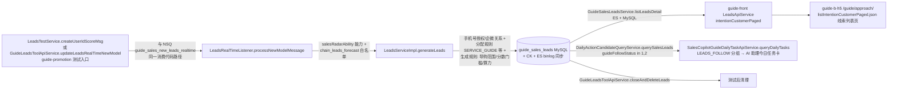

# briar-youzan-sales-leads-push — 指定导购推销售线索

> 只用于 QA/预发测试店铺与测试导购。写接口（造线索、关闭线索）**不得**对生产调用；
> `zan-dubbo-invoke` 在预发/生产只允许只读方法（客户端白名单，按方法名前缀拦截），
> QA 走 Tether 无方法限制可直连；**预发的写操作**复用 `dubbo_query.py` 的 funeng 登录态
> 直接 `POST https://ticket.qima-inc.com/api/v1/dubbo/invoke`（body 同 DubboMan：
> `{app,env,service,method,args,sc,timeout,retries}`），与用户在 DubboMan 手动点 Send 等价，
> 也可用 kimi-webbridge 在用户已登录的 ticket 页面上下文中发同样的请求。

## 快速通道（例行造数，推荐）

`scripts/sales_leads_push.py` 已把下文手动步骤固化成子命令（qa 走 Tether，pre 复用 zan-dubbo-invoke 的 funeng 登录态直调 Ticket；依赖 `ZAN_DUBBO_INVOKE_SKILL_DIR`，默认 `~/.kimi-code/user-skills/zan-dubbo-invoke`）：

```bash
S=~/.kimi-code/skills/briar-youzan-sales-leads-push/scripts/sales_leads_push.py   # 或本仓库内路径
# 一条命令造 N 条：查生效线索 → 选合格客户（专属导购+手机号授权+未被占用）→ 逐个推送 → 对比总数确认
python3 $S run --env pre --kdtId <kdtId> --rootKdtId <rootKdtId> --guideId <guideId> -n 3
```

- 默认**轻校验**：推完短轮询 `listLeadsDetail` 对比总数（ES binlog 同步有秒级~数十秒延迟，最多等 40s），打印新 leadsNo 即收工；不逐条查天网、不轮询今日任务聚合。店铺/导购首次使用或排查时才跑 `precheck`。
- 其他子命令：`precheck`（4 项只读核查一次跑完出 PASS/FAIL）、`list`（生效线索）、`pick`（只选客户）、`push`（推单条）、`cleanup --leadsNo`（关闭并删除）。
- 时间窗（近一年）与 `processTime` 由脚本内计算，不要手填毫秒（手填算错年份已踩过一次）。
- 输出 `HINT 写返回 true 但无新增` 时，按步骤 7 天网关键字表排查（skynet `/v3/skynet/log/search/search` 响应的日志列表在**顶层 `logEvents`** 字段，不是 `data.logs`）。
- 下面的手动步骤保留作排查手册与非常规场景（指定某个客户、指定特殊分数、验证今日任务聚合分组）使用。

## 链路总览



关键点：线索按 **`guideId` = 导购有赞 userId** 归属，由店铺「线索分配规则」决定分给谁——造数时消息里的 `slGuideId` 只是「推广导购」候选，**最可靠的定向方式是选专属导购就是目标导购的客户**（assignType=1 SERVICE_GUIDE 规则启用且优先级最高时必中）。今日任务「销售线索」分组与线索列表页读的是同一份数据（生效中 + 未查看/已查看），所以造出线索即同时出现在两处。

## 前置

1. 确认环境（QA / 预发）、总部 `rootKdtId`、导购 `guideId`（有赞 userId，须为有效**付费导购**）、推送条数 N。导购在 H5 页面 Console 读 `_global` 可拿：`buyer_id` = guideId、`kdtId` / `rootKdtId`、`nodeEnv=pre` 表示预发。
2. 依赖技能：`zan-dubbo-invoke`（Dubbo 调用与 funeng/Ticket 登录态）、`briar-youzan-skynet` 或 `skynet-query`（天网验证，查 PRE 环境日志需加 `_env=PRE` 条件）、`briar-youzan-get-session-id`（需要模拟导购登录 H5 时）。
3. 凭据只走各技能自身的登录态或环境变量，**不要**把 cookie / sessionId / token 写进任何文件或命令历史。

## 步骤

### 1. 定位导购（三选一，均为只读）

- 已知 `guideId`（有赞 userId）：
  ```bash
  python3 "$ZAN_DUBBO_INVOKE_SKILL_DIR/scripts/dubbo_query.py" \
    com.youzan.guide.api.service.shoppingguide.ShoppingGuideReadApiService.getShoppingGuide \
    --args '[{"rootKdtId":<rootKdtId>,"guideId":<guideId>}]' --env <qa|pre>
  ```
  确认 `status=1`、`guideType=1`（付费导购）。非付费导购在「专属导购」分配策略下会被跳过（`GuideTypeEnum.PAY` 校验）。
- 只有手机号或昵称：`ShoppingGuideReadApiService.listPaged`，args `[{"rootKdtId":<rootKdtId>,"mobile":"<手机号>","page":1,"pageSize":10}]` 或 `{"rootKdtId":...,"nickName":"<昵称>",...}`（也支持 `keyword` 模糊），从结果取 `userId` 作为 guideId。

### 2. 店铺侧只读核查（任一不满足都会在生成时被静默跳过）

```bash
# 新评分模型白名单（chain_leads_forecast），true 才能走新模型造数
...GuideSalesLeadsConfigApiService.getLeadsForecastSwitch --args '[{"rootKdtId":<rootKdtId>}]'
# 分配规则：确认 assignType=1（专属导购）status=1 且 priority 最高；assignType=5（店长分配高等级客户）启用时，高等级会员的线索会进「待店长分配」而不是给导购
...GuideSalesLeadsConfigApiService.getLeadsConfig --args '[{"rootKdtId":<rootKdtId>}]'
# 导购在线索生成范围内（ bizType=1 销售线索）
...GuideGenerateScopeApiService.checkGuideInGenerateScope --args '[{"rootKdtId":<rootKdtId>,"bizType":1,"guideId":<guideId>}]'
# 商家 AI 算力余额 computeEnough=true
...GuideAiComputeApiService.getAccount --args '[{"rootKdtId":<rootKdtId>,"kdtId":<rootKdtId>}]'
```

服务名前缀均为 `com.youzan.guide.promotion.api.service.leads.`（算力为 `.ai.compute.GuideAiComputeApiService`）。

### 3. 选客户（每个客户 = 一条线索；客户复用只会更新旧线索）

```bash
python3 "$ZAN_DUBBO_INVOKE_SKILL_DIR/scripts/dubbo_query.py" \
  com.youzan.guide.front.api.service.customer.CustomerReadApiService.listCustomersPaged \
  --args '[{"operator":{"operatorKdtId":<kdtId>,"operatorId":<guideId>},"formSence":2,"kdtId":<kdtId>,"guideUserIds":[<guideId>],"page":1,"pageSize":20}]' --env <qa|pre>
```

从导购的专属客户里挑 N 个，硬性要求：

- `belongGuideInfo.guideUserId` = 目标导购（专属关系是定向分配的锚点）；
- `mobileAuth=true`（或该客户与任一导购有企微好友关系），否则 `doSaveLeads` 直接跳过；
- 不能是导购本人（`checkUserIsGuide` 过滤）；
- 避开当天有成交的客户（当日成交 Redis tag 会关线索，隔天自动失效不影响）；
- 客户当前**没有生效中线索**（有的话本次推送走 `doUpdateLeads`：只更新分数/置未读，不新增条数）。当前生效线索可用步骤 5 的 `listLeadsDetail` 查。

### 4. 造线索（写操作）

**QA 环境**（Tether 无方法限制）：

```bash
python3 "$ZAN_DUBBO_INVOKE_SKILL_DIR/scripts/dubbo_query.py" \
  com.youzan.guide.promotion.biz.service.test.LeadsTestService.createUserIdScoreMsg \
  --app guide-promotion --env qa \
  --args '[{"yzUid":<customerUserId>,"rootKdtId":<rootKdtId>,"totalScore":75,"type":"DISPLAY","slGuideId":<guideId>,"processTime":<当前毫秒>,"newModel":1,"generateSource":0}]'
```

**预发环境**（绕过 zan-dubbo-invoke 客户端只读白名单，复用其 funeng 登录态直调 Ticket API）：

```bash
cd "$ZAN_DUBBO_INVOKE_SKILL_DIR/scripts" && python3 - <<'EOF'
import json, time, importlib.util
spec = importlib.util.spec_from_file_location("dq", "dubbo_query.py")
dq = importlib.util.module_from_spec(spec); spec.loader.exec_module(dq)
req = dq.build_dubbo_request(
    app="guide-promotion",
    service="com.youzan.guide.promotion.biz.service.test.LeadsTestService",
    method="createUserIdScoreMsg",
    args=[{"yzUid": <customerUserId>, "rootKdtId": <rootKdtId>, "totalScore": 75,
           "type": "DISPLAY", "slGuideId": <guideId>,
           "processTime": int(time.time()*1000), "newModel": 1, "generateSource": 0}],
    env="pre", timeout=15000, retries=0)
result = dq.invoke_dubbo_service(req, dq.get_cookies_from_funeng())
print(json.dumps(result, ensure_ascii=False))
EOF
```

参数说明：

- `yzUid` = 客户 userId；`slGuideId` = 目标导购 userId（仅作「推广导购」分配策略输入，定向主要靠客户专属关系）；
- `totalScore`：1–100 整数，>0 才会新建；>=60（`HIGH_INTENTION_SCORE`）标记高意向；今日任务卡里展示为 score/10（如 88 → 8.8 分）；
- `newModel=1` 必填：走新评分模型链路（店铺在白名单内时旧链路 `processLeads` 直接拒绝）；`processTime` 传当前毫秒（早于线索已有 processTime 会被当迟到消息忽略）；
- `type` 任意枚举值（`DISPLAY`/`TRADE`/`ADDCART`/`ADVISORY`/`INTERACTIVE`/`SEARCH`/`NO_MALL_BEHAVIOR`），只影响来源解析；
- 返回 `data:true` 只表示消息被同步处理完，**不代表线索生成**（中间有十几个静默 return 分支），必须按步骤 5/6 验证；
- 等价入口：`com.youzan.guide.promotion.biz.fix.GuideLeadsToolApiService.updateLeadsRealTimeNewModel(<同一消息体>)`，与 NSQ topic `guide_sales_new_leads_realtime` 的消费代码完全同路径。

### 5. 验证线索已生成（只读）

```bash
# 生效中线索列表（ES + MySQL，binlog 同步实测秒级；查不到先等 10s 重试）
...leads.GuideSalesLeadsService.listLeadsDetail --env <qa|pre> --args '[{"rootKdtId":<rootKdtId>,
  "guideIdList":[<guideId>],"leadsStatusList":[0],
  "startTime":<近一年起始毫秒>,"endTime":<当前毫秒>,
  "page":1,"pageSize":20,"rankOrderBy":"score","descOrderBy":true}]'
```

命中标志：出现新 `leadsNo`（GL 开头），`guideId`=目标导购，`guideFollowStatus`=1（未查看）。

### 6. 验证今日任务「销售线索」分组（只读，导购视角）

```bash
# 首次不传 queryId，返回 PROCESSING + queryId；sleep 15s 后带 queryId 轮询到 SUCCESS
...ai.copilot.SalesCopilotGuideDailyTaskApiService.queryDailyTasks --env <qa|pre> \
  --args '[{"date":"<yyyy-MM-dd>","rootKdtId":<rootKdtId>,"guideId":<guideId>}]'
...queryDailyTasks --args '[{"date":"<yyyy-MM-dd>","rootKdtId":<rootKdtId>,"guideId":<guideId>,"queryId":"<queryId>"}]'
```

`tasks[]` 出现 `taskType=LEADS_FOLLOW`、`customerId`=所造客户即端到端打通。H5 侧：导购身份打开工作台，AI 助理今日任务卡「销售线索」分组与线索列表页（路由 `SalesApproach`）展示同批线索。

### 7. 天网验证 / 排查（生成被静默跳过时）

`skynet-query` 的 CLI 有 bug，用内联调 `_request('/v3/skynet/log/search/search', payload)`（响应日志列表在**顶层 `logEvents`**，不是 `data.logs`），payload 里加 `"tagConditions":[["_env","eq","PRE"]]`（预发日志）、`"app":"guide-promotion"`、`"queryString":"<customerUserId>"`，时间窗取推送前后几分钟。按时间序看关键日志：

| 日志 | 含义 |
|---|---|
| `LeadsTestServiceImpl#createUserIdScoreMsg` | 写调用到达 |
| `生成线索时，新评分模型：执行完成` | 过了能力/白名单校验，进 generateLeads |
| `销售线索实时处理中，开始处理线索信息 ... assignGuide：...` | 分配结果，看 `guideId` 是否目标导购、`leadsAssignRuleType` 命中哪条规则 |
| `线索评分解读生成完成,发送画像话术触发消息 ... "leadsNo":"GL..."` | **线索已落库** |
| `客户没有授权并且客户和商家的导购都不存在企微好友关系` | 换 mobileAuth=true 的客户 |
| `用户是导购，该线索不处理` / `客户账户是旧账户` / `客户有订单成交，不予处理` | 换客户 / 隔天再试 |
| `doSaveLeads 线索不能进行评分解读` | canExplain 拦截（apollo 白名单+分数区间内要求评分解读可生成）；换客户或把分数调到配置区间外 |
| `销售线索生成规则未通过，不生成导购线索` | 导购不在生成范围 / 分数低于店铺门槛 / 算力不足（回步骤 2 逐项核对） |
| `客户在导购销售线索黑名单` / `命中导购黑名单` | 换客户或换导购 |

### 8. 清理（恢复现场，写操作）

```text
com.youzan.guide.promotion.biz.fix.GuideLeadsToolApiService#closeAndDeleteLeads(<rootKdtId>, "<leadsNo>")   # 关闭并删除
com.youzan.guide.promotion.biz.fix.GuideLeadsToolApiService#closeLeadsForAll(<rootKdtId>, "<leadsNo>")      # 仅关闭
```

调用方式同步骤 4（QA 直连 / 预发走 Ticket API）。

## 已验证（2026-10-22，pre）

店铺 kdtId 132015756 / rootKdtId 136579309，导购「导购好存西溪路店」guideId=949048242：

- 核查：白名单开、assignType=1 启用 priority=6（最高）、导购在生成范围、算力充足；
- 导购专属客户 6 个，选 mobileAuth=true 的 393811488、33039585；
- 各推 1 条（75 分 / 65 分）→ 生成 `GL425226900`、`GL425226901`，`listLeadsDetail` 秒级可见（guideFollowStatus=1）；
- `queryDailyTasks` 轮询 SUCCESS 后返回 3 个 LEADS_FOLLOW 任务（含原有 88 分线索 GL1045576630）。

## 排查速查

| 现象 | 处理 |
|---|---|
| 写返回 true 但列表没有 | 90% 是静默跳过分支，按步骤 7 天网关键字定位 |
| 线索生成但不在目标导购名下 | 该客户专属导购是别人 / 命中店长分配规则（assignType=5，高等级会员）；换客户 |
| 同客户再推条数不变 | 生效线索只会被 `doUpdateLeads` 更新（分数、置未读），要新增条数必须换客户 |
| 今日任务分组没有新线索 | 分组只取 guideFollowStatus in (1,2) 且生效中；导购已跟进的不会出现；`queryDailyTasks` 是异步聚合，必须轮询到 SUCCESS |
| 列表接口 3300 限制 / 查不到旧线索 | `listLeadsDetail` 走 ES，startTime 别给太宽；历史关闭线索在 history 表 |

## 来源

- guide-promotion：`LeadsTestServiceImpl#createUserIdScoreMsg`、`GuideLeadsToolApiService(Impl)`、`LeadsRealTimeListener`、`LeadsServiceImpl#generateLeads/doSaveLeads/doUpdateLeads`、`GuideSalesLeadsAssignRuleDomainServiceImpl`（分配规则优先级）、`GuideSalesLeadsGenerateRuleDomainServiceImpl`（范围/分数/算力）、`GuideSalesLeadsScoreExplainServiceImpl#canExplainText`、`DailyActionCandidateQueryService#querySalesLeads`
- guide-front：`LeadsApiServiceImpl#intentionCustomerPaged`（列表 = ES `listLeadsDetail` + MySQL 回表）
- guide-b-h5：`client/api/approach.ts`、`app/controllers/salesman-approach/SalesmanApproachController.ts`、`app/controllers/center/AiAssistantController.ts`
